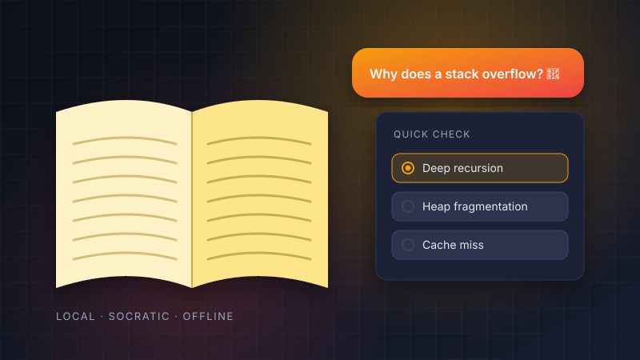
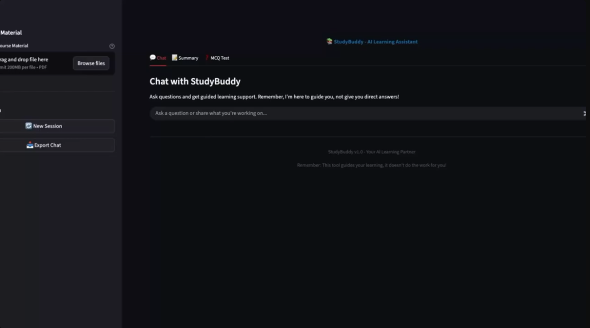

<!-- portfolio:start -->
<div align="center">



# StudyBuddy

**Local AI tutor that teaches through Socratic questioning**

 [](https://ashween.space/projects/studybuddy)

</div>

## About

Turns course PDFs into guided study sessions with summaries, multiple-choice questions (MCQs) and tiered Socratic prompts. Runs fully offline with progress saved in SQLite.

Developed StudyBuddy, a privacy-first AI tutor that guides students through course materials using a Socratic questioning approach.

The system processes PDFs locally through Ollama, so student data never leaves the device, and provides automated summarisation and interactive multiple-choice question (MCQ) generation.

Implemented tiered learning logic that encourages deep reasoning, backed by a local SQLite database that saves learning progress and session history.

| | |
|---|---|
| **Project** | StudyBuddy: Local AI Learning Assistant |
| **Project type** | Local LLM Application |

## Demo

<p align="center"><a href="https://www.youtube.com/watch?v=h2hhqg-UJOc"></a><br/><sub>▶ StudyBuddy demo (YouTube)</sub></p>

## Tech stack

`Python` · `Streamlit` · `Ollama` · `Llama 2` · `Mistral` · `DeepSeek-R1` · `SQLite`

> Full write-up on the portfolio: **[ashween.space/projects/studybuddy](https://ashween.space/projects/studybuddy)**

<!-- portfolio:end -->

---

## Overview

**StudyBuddy** is a Streamlit-based AI tutor designed to guide students through course materials using Socratic questioning and scaffolding. By leveraging local LLMs, it ensures that all PDF processing, summarization, and quiz generation happen entirely on your machine.

## 🚀 Key Features
* **Socratic Tutoring:** Instead of giving direct answers, the AI guides you through complex concepts using tiered questioning.
* **Privacy-First:** Process PDFs locally via Ollama; no data ever leaves your device.
* **Automated Summarization:** Generate concise breakdowns of long lecture notes or textbooks.
* **Interactive MCQs:** Create custom practice tests based on your uploaded content with instant feedback.
* **Session History:** All learning progress is persisted in a local SQLite database.

---

## 🛠 Prerequisites

Ensure your system meets the following requirements:
* **Python:** 3.8 or higher.
* **Ollama:** Installed and running (for local LLM inference).
* **Hardware:** * 8GB RAM minimum.
    * 16GB RAM recommended.

### Recommended Models
Choose a model based on your hardware capabilities:

```bash
ollama pull llama2:13b        # Best balance of logic and speed (7.3GB)
ollama pull mistral:7b        # Faster, smaller footprint (4.1GB)
ollama pull deepseek-r1:7b    # Optimized for STEM and reasoning (4.7GB)
```

> **Note:** Verify Ollama is active by visiting `http://localhost:11434/api/tags` in your browser.

---

## ⚙️ Setup Instructions

Follow these steps to set up the project environment:

1.  **Clone the repository:**
    ```bash
    git clone <your-repo-url>
    cd study-buddy
    ```

2.  **Create a virtual environment:**
    ```bash
    # On macOS/Linux:
    python3 -m venv study-buddy
    source study-buddy/bin/activate

    # On Windows:
    python -m venv study-buddy
    study-buddy\Scripts\activate
    ```

3.  **Install Python dependencies:**
    ```bash
    pip install -r requirements.txt
    ```

4.  **Run the Application:**
    Ensure Ollama is running in the background, then start the interface:
    ```bash
    streamlit run streamlit_app.py
    ```

---

## 📖 How to Use

### 1. Upload & Process
Visit `http://localhost:8501` in your browser. Use the sidebar to click **"Browse files"** and upload your course PDF. The system will extract the text automatically.

### 2. Learning Modules
* **Socratic Chat:** Type questions in the **Chat** tab. The AI will guide you through tiers of learning—from basic clarification to deep resource pointers.
* **Summarization:** Click **"📝 Summarize"** to generate a high-level overview of your materials in the **Summary** tab.
* **Practice Tests:** Click **"❓ Generate MCQ"** to create a custom test. Head to the **MCQ Test** tab to answer questions and view explanations.

---

## 🔧 Troubleshooting

| Issue | Solution |
| :--- | :--- |
| **"Cannot connect to Ollama"** | Ensure the Ollama service is running locally on port `11434`. |
| **"Request timed out"** | The model may be too heavy for your RAM. Try a smaller model like `mistral:7b`. |
| **"Error extracting text"** | Ensure the PDF is not password-protected and contains selectable text (not scanned images). |
| **Database Errors** | Reset session history by deleting the `study_buddy.db` file in the root directory. |

------------------------------------------------------------------------

## Demo Video

Watch the demo of the application:

[](https://youtu.be/h2hhqg-UJOc)

------------------------------------------------------------------------

Developed by Ashween R
